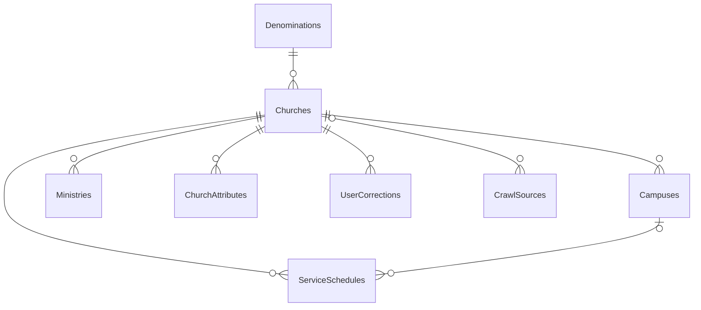

# Architecture

## Bird's-eye view

One ASP.NET Core Minimal API, `Directory`, reads and writes a SQL Server church directory through plain ADO.NET. The
schema lives in its own SQL project, `Directory.Data`, published before the app. Writes that need slow work (geocoding
an import row, crawling a source, applying a user's correction) are not done here: the API sends a message to an Azure
Service Bus queue, and a separate processing pipeline consumes it.

## Codemap

| Part | What it does |
|---|---|
| `Directory/Program.cs` | configuration, one scoped `DbConnection` from `SqlClientFactory.Instance`, the Service Bus client, JWT authentication and the `Directory` and `ChurchesMod` policies, health checks, the production-only telemetry and data protection |
| `Directory/Church`, `Schedules`, `Ministries`, `Campuses` | church CRUD and merge, and each child resource; `Church/Optional{T}.cs` carries the `PATCH` absent-versus-null distinction |
| `Directory/Search` | `/search`: filters bound through `[AsParameters] SearchRequest`, a count statement and a page statement over one shared `FROM`/`WHERE`; `RelevanceOrder.cs` holds the keyword relevance `ORDER BY` |
| `Directory/Denomination`, `Admin`, `Crawling`, `Moderation`, `User` | denominations, CSV import and export, crawl sources and triggers, the corrections lifecycle, `/me` |
| `Directory/Entities`, `Enums`, `Messaging` | the row types, enums, and the queue names (`Messaging/ServiceBusNames.cs`) |
| `Directory/AuthorizationPolicies.cs`, `SqlParameters.cs`, `Moderation/SubjectClaims.cs` | policy and claim names, every SQL parameter name, and `sub` parsed once as a `Guid` |
| `Directory.Data` | the schema: tables, indexes, `fn_HaversineDistance`, the full-text catalog, pre- and post-deployment scripts (the post-deployment script seeds `Denominations`) |
| `Directory.Tests.Unit`, `Directory.Tests.Integration`, `Directory.Tests.FullText` | the unit tier, the integration tier, and the full-text tier kept apart for mutation testing ([TESTING.md](TESTING.md)) |
| `.github/workflows/main_crgolden-directory.yml` | build, inspect, test, mutation-test, analyze, then deploy the schema and the app |
| `stryker-config.json`, `stryker-relevance-config.json`, `coverage.settings.xml`, `dotnet-tools.json`, `NuGet.Config`, `global.json` | mutation settings, integration coverage settings, pinned tools, package sources (the `Shared` package from GitHub Packages), the SDK |
| `gate.ps1` | the maintainers' local gate (README.md, "Gate") |

Each feature folder holds an `*Endpoints.cs` (route wiring, excluded from coverage) and, except `User`, a scoped
`*Service.cs`.

## Invariants

- **Validate before SQL.** The church, campus, ministry and schedule services build and discard the matching
  `Shared.Domain` builder before writing, so a bad value fails with an `ArgumentException` naming the field rather than
  as a SQL constraint violation.
- **Each route, SQL parameter and JSON name has one home**: each `*Endpoints` class's `Route` builds both the mapping
  and the `Created`/`Accepted` location, every parameter name is a `SqlParameters` constant, and `ChurchJsonNames` is
  both the JSON name on `Church` and the set of correctable fields.
- **`State` is the `StateCode` enum, and a stored code outside the USPS set drops the row on read**: import skips it,
  list and search omit it, a single lookup is 404. Export keeps the stored value so an admin can find bad rows. A
  caller supplying a bad code gets 400. On the wire `State` is the two-letter code and `WorshipStyle` a number, so the
  string converter is per property, never global.
- **Every temporal column is `DATETIMEOFFSET (7)`**: the code writes `DateTimeOffset.UtcNow` and reads
  `DateTimeOffset`.
- **Every stored OIDC subject is a `UNIQUEIDENTIFIER`**; a machine-made merge suggestion records `NULL`. A missing or
  non-GUID `sub` answers 401 on every moderation route.
- **Search counts then pages in two statements**, never `COUNT(*) OVER()`, which materializes every match to serve one
  page.
- **`POST /corrections` writes nothing to SQL**; it only queues the correction.

## Search

`GET /search` (`Search/SearchService.cs`) builds one `FROM`/`WHERE` from the filters present and runs it twice in
one command: `SELECT COUNT(*)`, then the page with `OFFSET`/`FETCH`. `pageSize` is clamped to 1 to 50.

- **Text**: each word becomes a prefix term (`"word*"`) and its own `CONTAINSTABLE` join over
  `(CanonicalName, City)`, so every word must match.
- **Location**: `dbo.fn_HaversineDistance` (miles, Earth radius 3958.8) keeps churches within `radiusMiles`
  (default 25). A radius without `lat` and `lng`, or one not above zero, is a 400.
- **Schedule**: `dayOfWeek` and the start-time window filter through an `EXISTS` over `ServiceSchedules`.
- **Order**: with text, an exact name first, then a name prefix, then the summed full-text rank; with a location and
  no text, by distance; otherwise by name. An explicit `sort` of `name`, `distance` or `relevance` overrides it.

## Data model

- `Churches.Slug` is unique; `CanonicalName` and `City` carry the full-text index; `IsActive` is a soft delete;
  `ConfidenceScore` is `DECIMAL(5,4)`, computed by the processing pipeline; `(0,0)` coordinates mean not yet geocoded.
- `Campuses`, `Ministries`, `ServiceSchedules`, `ChurchAttributes` and `UserCorrections` cascade-delete with their
  church. `CrawlSources.ChurchId` is nullable, and its foreign key has no delete action: a source links to a church
  after its first successful crawl.
- `UserCorrections.UserId` is the submitter's `sub`, `NULL` for a machine-made merge suggestion; `ReviewedBy` is the
  moderator's.
- `MergeAuditLog` (`SurvivingId`, `AbsorbedId`, `MergedBy`) has no foreign keys, so it outlives both churches.
- The post-deployment script seeds `Denominations`.

## Writes and messages

Moderator operations write SQL directly: church CRUD, child curation, correction approve and reject, and merge. A
merge is one transaction that repoints every child row to the surviving church, soft-deletes the absorbed one and
writes a `MergeAuditLog` row. Everything else is sent to the processing pipeline:

| Endpoint | Queue |
|---|---|
| `POST /admin/import` (CSV, one message per row) | `geocoding-requests` |
| `POST /crawl-sources/{id}/trigger` | `scrape-requests` |
| `POST /corrections` | `contributions` |

## Boundaries

- SQL Server is the store; the schema project is its definition. Other writers (the processing pipeline) write the same
  catalog, including `ConfidenceScore`.
- The API only sends to Service Bus (`geocoding-requests`, `scrape-requests`, `contributions`); it consumes nothing.
- It trusts any token from `OidcAuthority`: `scope=directory` for corrections, the `churches.mod` claim for moderation.

## Cross-cutting concerns

- **Mutation score is 100**: Stryker.NET runs over the unit tier at thresholds of 100 in CI and the gate.
- **Telemetry** is production-only: OpenTelemetry over OTLP and Serilog to an Elasticsearch data stream.
- **Warnings are errors**, and CI also fails on any `jb inspectcode` result and any open SonarCloud issue.
- **Index builds block writes** on a SQL Server edition without online index operations, so a new index is published
  knowing the table is locked for the build.
